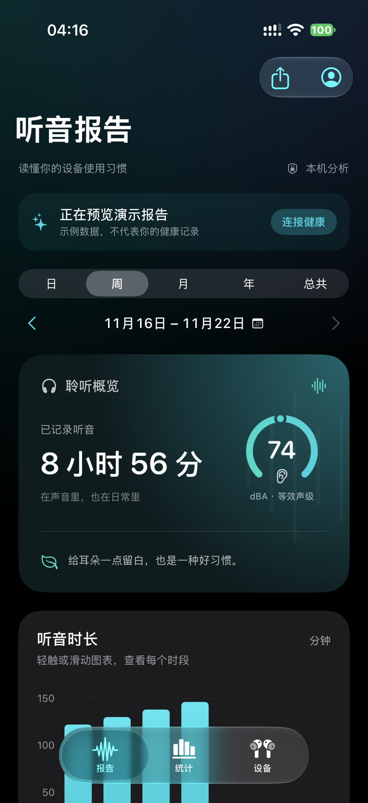
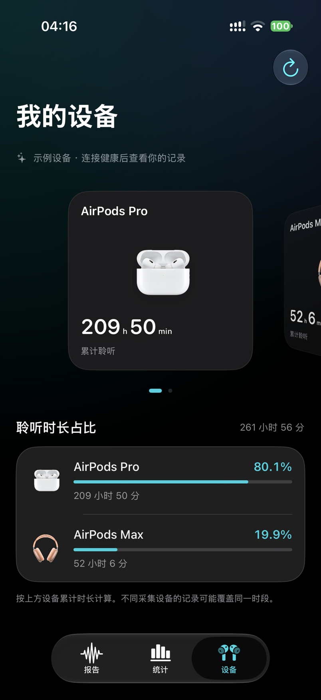
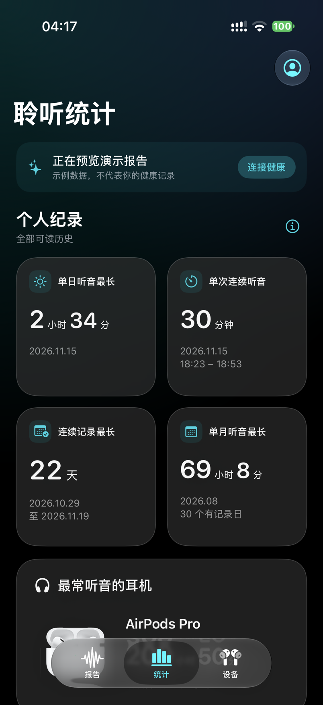

  

<h1 align="center">即刻匣</h1>

了解你的 Apple 设备，发现藏在日常里的小细节。

即刻匣是一款帮助用户了解自己的 Apple 设备、发现隐藏信息、解决日常小问题的精致工具 App。我们希望把平时散落在各处、不容易读懂的信息，整理成清楚、直观、随手可看的答案。

现在，先从耳机使用与听觉健康开始。

## 从每一次聆听，了解自己的习惯

- **听音报告**：按日、周、月、年或全部历史，回顾听音时长、声音水平和使用趋势。
- **听音日历**：每天听了多久，直接显示在日期下方，翻翻日历就能找到。
- **我的设备**：用实物图片与可滑动的设备卡片，查看耳机档案、使用时长和占比。
- **个人纪录**：回看最长的一天、最长的一次、连续有听音记录的日子，以及最常使用的耳机。
- **设备细节**：查看可识别耳机的型号、连接状态与历史使用情况，让设备信息更容易理解。

## 看看现在的即刻匣

下面是当前开发版本在 iPhone 17 Pro 上的真机截图，均使用演示数据。界面还在持续打磨。

<table>
  <tr>
    <th>听音报告</th>
    <th>我的设备</th>
    <th>个人纪录</th>
  </tr>
  <tr>
    <td></td>
    <td></td>
    <td></td>
  </tr>
</table>

## 简洁，也认真对待你的数据

以熟悉的系统交互呈现信息，支持浅色与深色外观。健康记录在本机分析，不上传到服务器；是否允许读取，由你决定。

听音统计来自可读取的声音记录，反映已记录的聆听情况，并不等同于完整的耳机佩戴时间。

即刻匣正在开发中。目前专注 iPhone，未来会围绕 Apple 设备带来更多实用的小工具。
